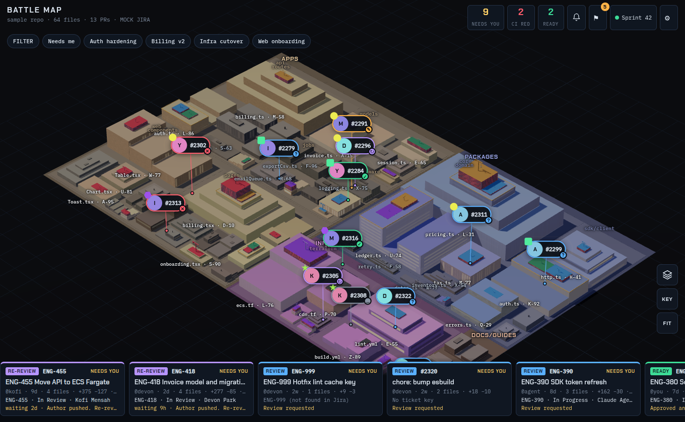
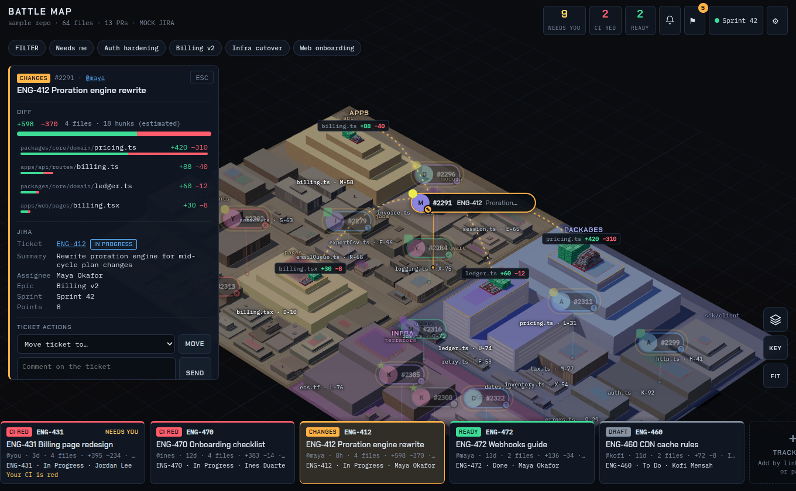
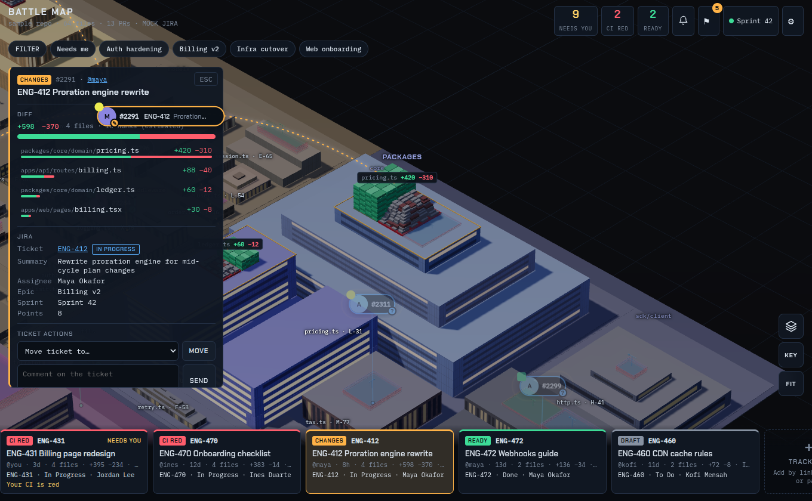
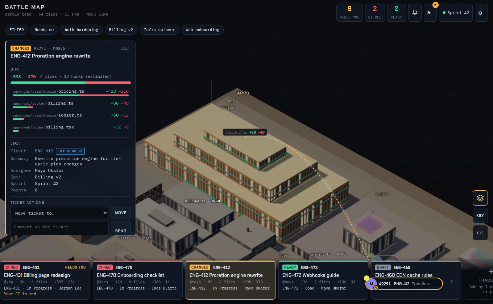
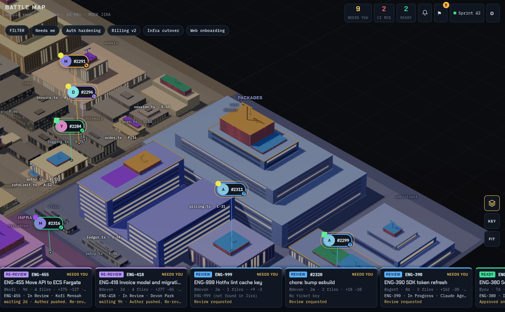
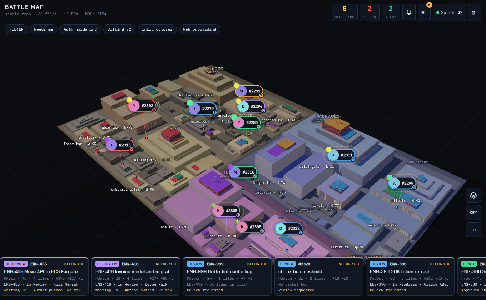
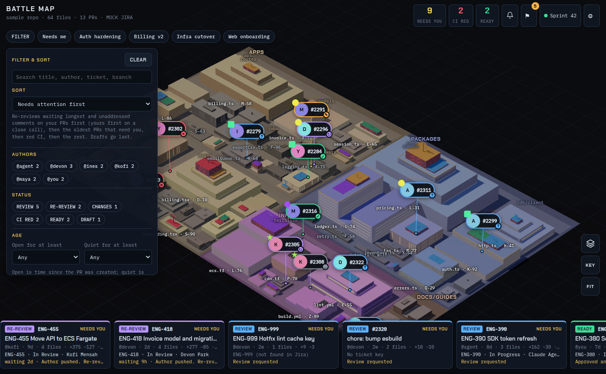
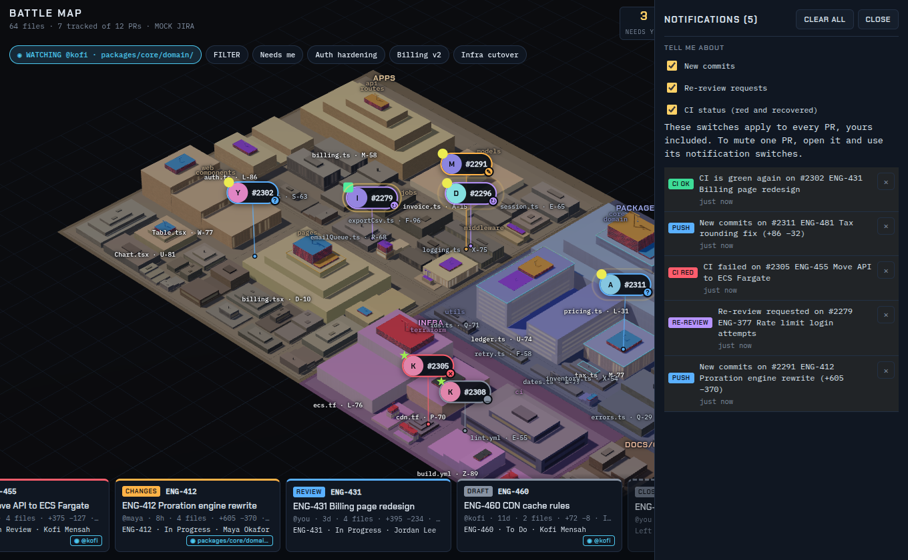
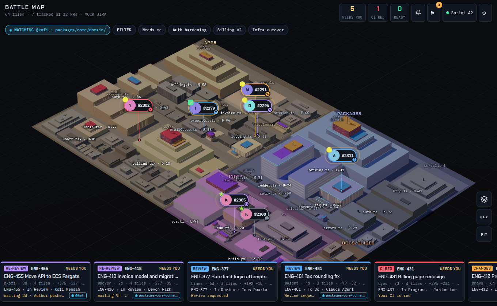
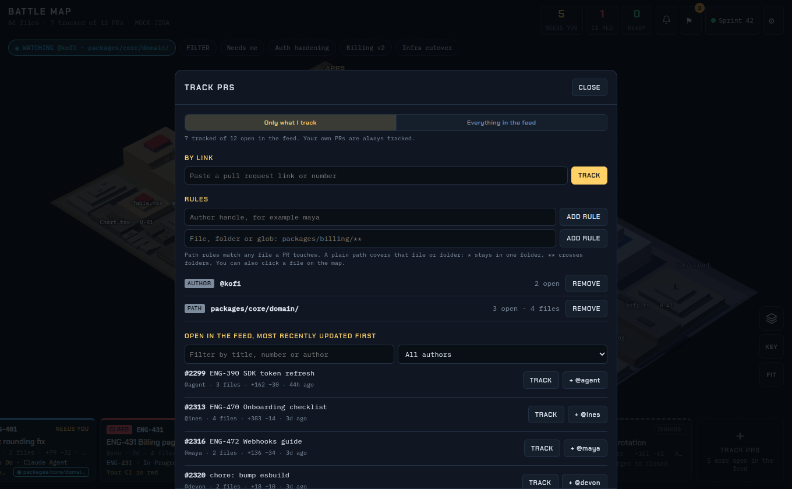

# Battle Map

A geospatial visualization of code, PRs, and tickets. Files are buildings, folders are districts, open PRs are
toppers standing on the buildings they change, and Jira tickets hang off the PRs.

```
npm install          # pulls three.js
npm start            # sample repo + sample PRs         -> http://localhost:4747
npm run mock         # same, plus a fake Jira to play with
battlemap --repo ~/code/my-project --prs prs.json        # your repo, your PRs
```

Needs Node 20+. `npm link` gives you a global `battlemap` command.

## What you see



* **Footprint** = lines of code. **Height** = complexity. **Colour** = top-level package. Same file list, same map, every time.
* **Buildings.** Every file also gets a look of its own, derived from a hash of its path: a shade inside its folder's colour, a silhouette (block, stepped, crown, L-shape, tower on a podium, terraced slabs or twin towers), a wall material (concrete, brick, stone or steel), a window pattern with its own window size, share of lit windows and warm glow, and a rooftop detail (antenna, water tank, vents). Each building also keeps a margin of its own inside its lot, so there are gaps and a mix of widths, like blocks of a city. The same file always looks the same, so neighbours in one folder are easy to tell apart without reading labels, and the folder colour still reads from far away. A short **index code** on each roof (`C-14`) gives people a name to say out loud: "look at C-14". It also shows in the hover tip and the file bar. Footprint still follows lines of code and height still follows complexity.
* **Toppers.** Each PR that touches a file raises a column on that roof. Its **width** is the share of the file the PR changes (at least 20%, so one-line edits still show), and two PRs on one file split the roof. Its **height** is lines changed (adds + dels) on one global scale, so any two toppers on the map compare by eye. Layers > Spires switches the height scale between square root (default), linear and log, and the width between "Share of file" and "Slim".
* **Construction sites** (Layers > Buildings > Buildings; Plain and Colours keep the toppers). One rule keeps them comparable: **height is lines, on the one global scale the toppers use**. A PR that adds code to a file puts a **tower crane** on its roof, in the PR's status colour so it matches the flag. The whole crane is scaled by the lines added, whatever the file or roof, so 9 lines is the same small crane everywhere and 400 lines a big one. The flat **pad** under it is the share of the file changed (at least 20%), so that fact is still there without bending the size. A PR that **deletes** lines adds a **red-taped floor** stack, an emptied open frame with an X of tape on every face, as tall as the lines deleted on that same scale (one floor is 2.4 units, up to 24). **Focus a PR** and each of its files shows the change in the style you pick under Layers > Focused PR (which every building style offers: on Plain and Colours the overview keeps its toppers and only the focused PR changes, with the classic **Hunks** stack as their automatic choice). **Crates** (the default) is a yard on the roof: **additions on the left** as a solid stack of green crates on a pallet, **deletions on the right** as a rubble heap in a red skip. Both sides have the same footprint, the same baseline and the same 2.4-unit level height, and each is as many levels as its lines need on the one scale, so how much was added against how much was deleted is two stacks you can count; a side with nothing in it shows just its flat pad. **Facade** draws the additions as green scaffolding up the building's walls (with a ring in the PR colour on top, as high as the lines added, up to the building's fully walled height) and the deletions as red-taped floors on the roof. **File** makes the building the file: line 1 at the roof, the last line at the ground, and each hunk a green (added) and red (deleted) **belt** around the building at its place in the file, as thick as the share of the file it covers, following the tiers of the silhouette, with a ruler up one corner. It answers where in the file and how much of it; hunks may carry an optional `start` line (in the new file) to be placed exactly, and without it they are spread evenly in file order. Every other PR turns to glass. Two PRs on one roof, two cranes.
* **Contested files** (two or more PRs) get a static amber frame around the roof.
* **Focus a PR** (tap a card, flag or topper). Its columns split into hunks: red for deleted lines, green for added, heights proportional to lines. Every other PR turns to glass. Per-file `+n -n` floats over each topper and the left panel lists every file with a green/red bar. Moving dotted lines run from the flag to every file it touches.
* **Flags** are PRs, and each fact has its own channel so they can be told apart from far away: the text is the PR number, ring colour = status, fill = author, the corner emblem (shape and hue) = epic, gold pulse = needs you. Every PR in one epic wears the same emblem. **Fog of war** dims files nobody is working on.
* **Alerts** (flag icon) are drift between PRs and Jira: ticket Done but PR open, ticket To Do but PR up for review, ticket In Review with no PR, PR with no ticket key, ticket key that Jira does not know, and files two PRs fight over.
* **KEY** (corner button) explains every shape and colour.







### Layers

The three-sheets button in the corner opens the view and spire options: **2D**, **Isometric** (default) or **3D**; topper width and height scale; dotted lines for the selected PR, all PRs or none; fog of war, file names and PR flags.

**Buildings** (Layers menu) has three styles: **Plain** (one shade per folder, as before), **Colours** (each file gets its own shade inside its folder's family) and **Buildings** (the default: colours, silhouettes, windows and rooftop details). Under it: *Hue spread* (how far shades wander from the folder colour, 0 to 50 degrees), *Window density*, *Shape variety* (1 gives plain boxes, 7 uses every silhouette), *Height boost* (one multiplier for every building, so tall still means complex), *Wall textures* (brick, stone and steel; off leaves plain walls), **Reshuffle hash** (a new shuffle re-rolls every file's look and index code) and *Show index codes*. The choices are saved in the browser. On a roof with a PR, toppers stand on the real roof (the top step, the crown, or the tall half of an L) and the rooftop detail is left off, so toppers stay the most visible thing on the map. Windows and wall textures are painted by a shader, anti-aliased, and fade to an average colour when too small to see, so they never shimmer and cost no extra draw calls. A window's size is rolled once per building and then tiles across each wall.






Controls: left-drag pan, right-drag rotate (3D only), wheel zoom to cursor. Touch: one finger pans, two fingers zoom (and rotate in 3D). `Esc` leaves focus.

## Jira

Settings (gear) > Jira.

| | Data Center / Server | Cloud |
|---|---|---|
| Auth | Personal access token, `Authorization: Bearer` | Email + API token, Basic |
| REST | v2 | v3 (`/search/jql`) |
| Token from | Profile > Personal Access Tokens | id.atlassian.com > Security > API tokens |

* **Base URL** includes any context path (`https://host/jira`).
* **Which tickets**: a board's active sprint, or a JQL override, or `project in (KEYS) AND statusCategory != Done`. Tickets that PRs mention but the query misses are fetched by key.
* **Linking**: a PR links to a ticket when its title or branch matches the key pattern (default `[A-Z][A-Z0-9]+-\d+`) or when the PR sets `ticket`.
* **Fields**: Epic Link, Story Points and Sprint ids differ per site. "Detect fields" fills them in.
* **From the app** you can move a ticket to another status and comment on it (focus panel).
* The token is stored in `~/.config/battlemap/config.json` (mode 0600) and **never sent to the browser**; the UI only learns that one is set. Environment variables override the file and lock the field: `BATTLEMAP_JIRA_URL`, `BATTLEMAP_JIRA_TOKEN`, `BATTLEMAP_JIRA_EMAIL`, `BATTLEMAP_JIRA_DEPLOYMENT`, `BATTLEMAP_CONFIG` (alternate file).
* Jira down or rate limited: the last good data stays on screen and the Jira pill turns amber or red with the reason and a hint.

### Mock Jira

`battlemap --mock-jira [--mock-flavor server|cloud]` starts a fake Jira (default port 4748) and points the app at it for the session. Nothing is saved. It enforces auth (token `mock-token`, email `me@example.com`), paginates, supports a JQL subset, board and sprint endpoints, transitions, comments, field discovery, and has deliberately mismatched tickets so the Alerts panel has something to say. Poke it:

```
curl -X POST localhost:4748/__mock/chaos -d '{"mode":"500"}'   # off | 500 | 429 | 429-once
curl -X POST localhost:4748/__mock/reset
```

To point the real settings form at it: Data Center, `http://127.0.0.1:4748`, token `mock-token`, board 7.

## Feeding it PRs

Your existing integration writes a file or posts JSON:

```
battlemap --prs prs.json                 # reloads on change
curl -X POST localhost:4747/api/prs -H 'X-Battlemap: 1' -H 'Content-Type: application/json' -d @prs.json
```

```json
{ "prs": [{
  "id": "#2291", "number": 2291, "url": "https://github.com/org/repo/pull/2291",
  "title": "ENG-412 Proration engine rewrite", "branch": "maya/ENG-412-proration",
  "author": "maya", "ticket": "ENG-412",
  "status": "review_requested | re_review | changes_requested | ci_failing | ready_to_merge | draft | merged | closed",
  "files": [{ "path": "packages/core/domain/pricing.ts", "add": 420, "del": 310,
              "hunks": [{ "add": 30, "del": 2 }, { "add": 12, "del": 5 }] }]
}]}
```

Also optional: `createdAt` and `updatedAt` (ages and sorting), `headSha` (so pushes are noticed exactly), `mine` (true for your own PRs), and `waitingSince` (when the PR started waiting on you: for your own PR, its oldest unaddressed comment; for someone else's PR in re-review, when you were asked to review again; without it, `updatedAt` stands in). `hunks` are optional and in file order; without them focus mode estimates a plausible split that still sums to the file totals (marked "estimated"). `ticket` is optional. Whether a PR "needs you" is decided in `server/snapshot.js` `needsReason()`; change it there.

## Layout

```
bin/battlemap.js        CLI
server/                 config, Jira client + mock, snapshot join and insights, local repo scan
server/watch.js         what is tracked: picks, author and path rules, ended PRs (pure matching, tested)
bin/battlemap-sync.js   CLI: write the PR feed from GitHub / GitHub Enterprise
server/providers/       code-host adapters for the sync (github.js)
server/feedwatch.js     reload the feed file when it changes, even when replaced atomically
server/notify.js        notifications and policy: what happened to a tracked PR, what you want to hear (pure detection, tested)
deploy/                 systemd units, an installer and a crontab line
web/layout.js           deterministic treemap            (pure, tested)
web/spires.js           spire + hunk geometry plan       (pure, tested)
web/filters.js          filter, sort and age model       (pure, tested)
web/sigil.js            flag number, author colour, epic emblem (pure, tested)
web/scene.js            Three.js: instanced meshes, camera, overlay
web/main.js             panels, settings, Jira actions
```

`npm test` runs the suite (Jira client against the mock, server and security, layout and spire maths, flag sigils, a scene wiring smoke test). `npm run e2e` drives the real UI in Chrome against the mock (needs Playwright).

## Filtering and sorting



The **FILTER** chip opens a panel (or press `/` to jump straight to the search box). Everything in it is one model, so the tray, the header count and the map always agree about what is hidden:

* **Search** title, author, PR number, ticket key, branch or epic. Every word has to match.
* **Authors** (any of the ones you pick) and **status**, with how many PRs each has. Useful when there are no epics, or epics are not the useful cut.
* **Age.** *Open for at least* (since the PR was created) and *Quiet for at least* (since its last update) find the old and the neglected. A PR with no date never matches an age filter.
* **Sort** only changes the order of the cards in the tray; it hides nothing. The choices are needs attention first (the default), open longest, newest, recent activity, quiet longest, biggest change, and author. Merged and closed PRs always sink to the end.

  **Needs attention first** puts the PRs in this order, each group by PR number where it is otherwise a tie:

  1. **Waiting on us.** Someone else's PR in re-review, or one of ours with comments we have not addressed (a review or comment from someone else since our last push). The longest wait comes first, and on a close call (the same six hours) ours comes first. A card in this group says how long it has waited (`waiting 3d`).
  2. **Everything else that needs us**: a first review request, our own PR ready to merge, our own red CI. The **oldest PR** first, whatever the age of the request, as a nudge to get the oldest things closed.
  3. **Red CI** on someone else's PR.
  4. **The rest.**
  5. **Drafts**, at the back: they are allowed to be broken.
* The **Needs me** chip and the epic chips are part of the same model. *Needs me* means a PR of yours that is red or ready to merge, or anyone's PR waiting on your review.

Each card shows how old the PR is (`3d`, `2w`) next to the author, and clicking `@author` in a PR's panel shows only that author. Your choices are remembered between visits.

**Raise flags by age** (Layers menu) lifts old PRs on taller poles, so the ones that have been open longest stand out on the map; it grows with the square root of the age, so a week and a month both read.

## Notifications and alerts



The **bell** collects what happens to the PRs you track, so you do not have to watch the map. Three kinds, as you would want them:

* **New commits**: the PR's head commit changed (with `battlemap-sync` that is the commit sha; without one, its files or their sizes changed).
* **Re-review requests**: someone who already reviewed was asked to look again.
* **CI status**: CI went red, or recovered.

Each shows what happened, to which PR and when; click one to jump to the PR. A badge counts what you have not looked at yet, and a toast tells you when something arrives while the page is open. **Clear** one, or **Clear all**.

Notifications are worked out on the server by comparing each tracked PR with how it was last time, so they keep arriving while the browser is closed, and a change that happened while the server was down is announced when it starts. A PR seen for the first time, or a restart where nothing changed, announces nothing.

**You decide what you hear about.** The three switches at the top of the panel are a global policy: they apply to everything, your own PRs included. To quieten one PR, open it and use its notification switches (mute it entirely, or just one kind). Your own PRs have no per-PR switches: they always notify, so a stale mute can never hide news about your own work.

**Alerts** (the flag icon: ticket Done but PR open, PR with no ticket, and the rest) can be silenced one at a time with the ✕, or all at once. Silenced alerts move to a list you can reopen to restore them. That is the way to stop seeing, say, "no ticket key" on a PR that will never have one.

Notifications, mutes and silenced alerts are saved next to the config as `config.notify.json` (mode 0600), except under `--mock-jira`. Desktop (system) notifications are not part of this; it is in-app only.

## Running it for real

Everything above works from a file you feed it. To keep a map of a real repo live, with a cron job or systemd timer doing the feeding, you need three things: the code, a feed, and something to keep both fresh.

**1. A checkout to map.** A dedicated clone is best, because the timer below runs `git pull --ff-only` in it and you do not want that touching your working copy:

```
git clone git@github.com:org/repo.git ~/.local/share/battlemap/repo
```

**2. The feed, from GitHub or GitHub Enterprise.** `battlemap-sync` asks the [GitHub CLI](https://cli.github.com) for the open PRs and writes the feed file. `gh` does the login, so Battle Map never handles a GitHub token:

```
gh auth login                                  # for Enterprise: gh auth login --hostname ghe.example.com
battlemap-sync github --repo org/repo --out ~/.local/share/battlemap/prs.json
battlemap-sync github --repo org/repo --host ghe.example.com --out ...      # Enterprise
```

It maps each PR to a status (draft, red CI, changes requested, approved and green, re-review, review requested), marks the ones you opened as yours, works out exactly how long the PRs waiting on you have been waiting (for your own PRs and anyone's in re-review it reads their GitHub timeline: when you were re-requested for review, or when someone else's review or comment came in after your last push; twenty PRs per request, up to 100 PRs), and also includes PRs merged or closed in the last two days (`--ended-days`) so they show as MERGED or CLOSED instead of just vanishing. It writes the file atomically and, if GitHub cannot be reached, leaves the old file alone: a failed run never empties your map. Files per PR come from `gh`, which caps very large PRs; hunks are estimated.

**3. Keep it fresh.** The server reloads the feed whenever the file changes (including when it is replaced atomically), and `--rescan <seconds>` re-reads the checkout so new and changed files appear.

```
battlemap --repo ~/.local/share/battlemap/repo --prs ~/.local/share/battlemap/prs.json --rescan 600
```

To have that run by itself, with the feed refreshed every two minutes (and the checkout pulled), install the systemd user units:

```
deploy/install-systemd.sh --repo org/repo [--host ghe.example.com]
```

It writes `battlemap.service`, `battlemap-sync.service` and `battlemap-sync.timer` with absolute paths filled in, then enables them. Open `http://127.0.0.1:4747`. Logs: `journalctl --user -u battlemap -u battlemap-sync`. For a user service to keep running after you log out: `loginctl enable-linger $USER`. Without systemd, `deploy/crontab.example` has the one cron line that refreshes the feed.

Notes: it is one repository per feed. It binds to localhost and has no login, so leave it that way. Your tracking choices live in `~/.config/battlemap/`, not in the feed, so refreshing never loses them.

## Choosing what to track



The feed is the pool of everything open; the map only draws what you track, so a busy monorepo stays readable. Your own PRs (Settings > Display > Identity) are always tracked. Everything else is opt-in, from **+ TRACK PRS** at the end of the PR tray:

* **By link.** Paste a PR URL, `#123` or a number. If the PR is not in the feed yet, it is tracked as soon as it shows up.
* **By author.** "Track everything maya opens", from the list or a rule.
* **By path.** "Track any PR that touches `packages/billing/`". A plain path covers that file or folder, `*` stays inside one folder, `**` crosses folders. You can also click a file on the map and choose WATCH FILE or WATCH FOLDER. This is the one for teams that own part of a repo.
* **From the list.** Every untracked open PR, most recently updated first, with a filter by text and author.



**Reminders, so rules never surprise you.** A cyan `◉ WATCHING` pill at the top lists your rules (click it to edit them). Every file a path rule covers gets a cyan rim on the map, even with no PR on it (Layers > Mark watched files turns that off). A PR that a rule tracked carries a cyan tag naming the rule, and a toast says so when a rule newly pulls PRs in.

**Stop tracking** from the focus panel. A PR you stopped tracking stays off even if a rule still matches it; tracking it again by hand clears that.

**Ended PRs.** When a tracked PR merges, closes or drops out of the feed, it stays in the tray as a dashed MERGED or CLOSED card until you press DISMISS. A PR that left the feed is shown as CLOSED because the feed does not say whether it merged; a feed that sends `"status": "merged"` or `"closed"` gets the exact word. Ended PRs are not drawn on the map and do not raise Alerts. Rules never pull in a PR the feed already lists as merged or closed; only PRs you picked, or that were open and tracked a moment ago, get an ended card. Because "left the feed" means "ended", send every open PR on every update.

**Everything in the feed** (the toggle at the top of the dialog) turns opt-in off. That is also the default for the built-in sample, so the demo is not empty; the first real feed switches to opt-in.

Your choices are saved next to the config as `config.watch.json` (mode 0600), along with which PRs were open, so one that merges while the server is down still gets its card on the next start. Nothing is written under `--mock-jira`, and the built-in sample is never remembered. Rules are evaluated on the server, so they also apply to PRs that are opened later.

## Security notes

Binds to 127.0.0.1. Writes need an `X-Battlemap` header and a matching Origin, and the Host header is checked, so a web page you visit cannot drive it. There is no login: do not bind to a public address.

## Development

```
npm install      # also installs Playwright, which the e2e tests and screenshot script use
npm test         # unit + server + scene wiring tests (no browser needed)
npm run e2e      # drives the real UI in Chrome: Jira panels against the mock, then PR tracking end to end
```

The e2e tests need Chrome (set `CHROME` if it is not at `/usr/bin/google-chrome`); they render WebGL in software, so they work on a machine with no GPU. They write scratch files to the system temp directory; set `TMPDIR` to put them elsewhere. CI runs both `npm test` and `npm run e2e`.

`web/layout.js` (treemap), `web/spires.js` (diff layer plan) and `web/sigil.js` (flag identity) are pure and unit tested; `web/scene.js` is the Three.js glue. `server/watch.js` (what is tracked) is pure and unit tested too.

The screenshots above are generated, not hand-made. `e2e/shot2.mjs` runs against the mock Jira and sets up the scenes itself:

```
SHOTS_DIR=docs/screenshots node e2e/shot2.mjs shot:overview
SHOTS_DIR=docs/screenshots node e2e/shot2.mjs feed:sample rule:author:kofi rule:path:packages/core/domain/ pick:#2279 feed:sample-without-#2284 wait:2500 shot:tracking
```
