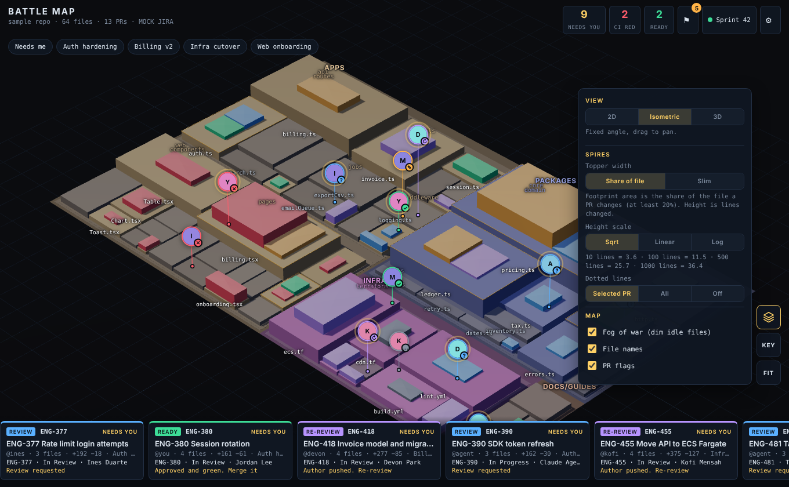

# Battle Map

A geospatial visualization of code, PRs, and tickets. Files are buildings, folders are districts, open PRs are
toppers standing on the buildings they change, and Jira tickets hang off the PRs.

```
npm install          # pulls three.js
npm start            # sample repo + sample PRs         -> http://localhost:4747
npm run mock         # same, plus a fake Jira to play with
battlemap --repo ~/code/my-project --prs prs.json        # your repo, your PRs
```

Needs Node 20+. `npm link` gives you a global `battlemap` command.

## What you see


* **Footprint** = lines of code. **Height** = complexity. **Colour** = top-level package. Same file list, same map, every time.
* **Toppers.** Each PR that touches a file raises a column on that roof. Its **width** is the share of the file the PR changes (at least 20%, so one-line edits still show), and two PRs on one file split the roof. Its **height** is lines changed (adds + dels) on one global scale, so any two toppers on the map compare by eye. Layers > Spires switches the height scale between square root (default), linear and log, and the width between "Share of file" and "Slim".
* **Contested files** (two or more PRs) get a static amber frame around the roof.
* **Focus a PR** (tap a card, flag or topper). Its columns split into hunks: red for deleted lines, green for added, heights proportional to lines. Every other PR turns to glass. Per-file `+n -n` floats over each topper and the left panel lists every file with a green/red bar. Moving dotted lines run from the flag to every file it touches.
* **Flags** are PRs: ring colour = status, fill = author, gold pulse = needs you. **Fog of war** dims files nobody is working on.
* **Alerts** (flag icon) are drift between PRs and Jira: ticket Done but PR open, ticket To Do but PR up for review, ticket In Review with no PR, PR with no ticket key, ticket key that Jira does not know, and files two PRs fight over.
* **KEY** (corner button) explains every shape and colour.


### Layers

The three-sheets button in the corner opens the view and spire options: **2D**, **Isometric** (default) or **3D**; topper width and height scale; dotted lines for the selected PR, all PRs or none; fog of war, file names and PR flags.




Controls: left-drag pan, right-drag rotate (3D only), wheel zoom to cursor. Touch: one finger pans, two fingers zoom (and rotate in 3D). `Esc` leaves focus.

## Jira

Settings (gear) > Jira.

| | Data Center / Server | Cloud |
|---|---|---|
| Auth | Personal access token, `Authorization: Bearer` | Email + API token, Basic |
| REST | v2 | v3 (`/search/jql`) |
| Token from | Profile > Personal Access Tokens | id.atlassian.com > Security > API tokens |

* **Base URL** includes any context path (`https://host/jira`).
* **Which tickets**: a board's active sprint, or a JQL override, or `project in (KEYS) AND statusCategory != Done`. Tickets that PRs mention but the query misses are fetched by key.
* **Linking**: a PR links to a ticket when its title or branch matches the key pattern (default `[A-Z][A-Z0-9]+-\d+`) or when the PR sets `ticket`.
* **Fields**: Epic Link, Story Points and Sprint ids differ per site. "Detect fields" fills them in.
* **From the app** you can move a ticket to another status and comment on it (focus panel).
* The token is stored in `~/.config/battlemap/config.json` (mode 0600) and **never sent to the browser**; the UI only learns that one is set. Environment variables override the file and lock the field: `BATTLEMAP_JIRA_URL`, `BATTLEMAP_JIRA_TOKEN`, `BATTLEMAP_JIRA_EMAIL`, `BATTLEMAP_JIRA_DEPLOYMENT`, `BATTLEMAP_CONFIG` (alternate file).
* Jira down or rate limited: the last good data stays on screen and the Jira pill turns amber or red with the reason and a hint.

### Mock Jira

`battlemap --mock-jira [--mock-flavor server|cloud]` starts a fake Jira (default port 4748) and points the app at it for the session. Nothing is saved. It enforces auth (token `mock-token`, email `me@example.com`), paginates, supports a JQL subset, board and sprint endpoints, transitions, comments, field discovery, and has deliberately mismatched tickets so the Alerts panel has something to say. Poke it:

```
curl -X POST localhost:4748/__mock/chaos -d '{"mode":"500"}'   # off | 500 | 429 | 429-once
curl -X POST localhost:4748/__mock/reset
```

To point the real settings form at it: Data Center, `http://127.0.0.1:4748`, token `mock-token`, board 7.

## Feeding it PRs

Your existing integration writes a file or posts JSON:

```
battlemap --prs prs.json                 # reloads on change
curl -X POST localhost:4747/api/prs -H 'X-Battlemap: 1' -H 'Content-Type: application/json' -d @prs.json
```

```json
{ "prs": [{
  "id": "#2291", "number": 2291, "url": "https://github.com/org/repo/pull/2291",
  "title": "ENG-412 Proration engine rewrite", "branch": "maya/ENG-412-proration",
  "author": "maya", "ticket": "ENG-412",
  "status": "review_requested | re_review | changes_requested | ci_failing | ready_to_merge | draft",
  "files": [{ "path": "packages/core/domain/pricing.ts", "add": 420, "del": 310,
              "hunks": [{ "add": 30, "del": 2 }, { "add": 12, "del": 5 }] }]
}]}
```

`hunks` are optional and in file order; without them focus mode estimates a plausible split that still sums to the file totals (marked "estimated"). `ticket` is optional. Whether a PR "needs you" is decided in `server/snapshot.js` `needsReason()`; change it there.

## Layout

```
bin/battlemap.js        CLI
server/                 config, Jira client + mock, snapshot join and insights, local repo scan
web/layout.js           deterministic treemap            (pure, tested)
web/spires.js           spire + hunk geometry plan       (pure, tested)
web/scene.js            Three.js: instanced meshes, camera, overlay
web/main.js             panels, settings, Jira actions
```

`npm test` runs 27 tests (Jira client against the mock, server and security, layout and spire maths, a scene wiring smoke test). `npm run e2e` drives the real UI in Chrome against the mock (needs Playwright).

## Security notes

Binds to 127.0.0.1. Writes need an `X-Battlemap` header and a matching Origin, and the Host header is checked, so a web page you visit cannot drive it. There is no login: do not bind to a public address.

## Development

```
npm test         # unit + server + scene wiring tests (no browser needed)
npm run e2e      # drives the real UI against the mock Jira (needs Playwright + Chrome)
```

`web/layout.js` (treemap) and `web/spires.js` (diff layer plan) are pure and unit tested; `web/scene.js` is the Three.js glue.
`e2e/shot2.mjs` renders screenshots, for example `node e2e/shot2.mjs shot:overview` writes `/tmp/overview.png`.
